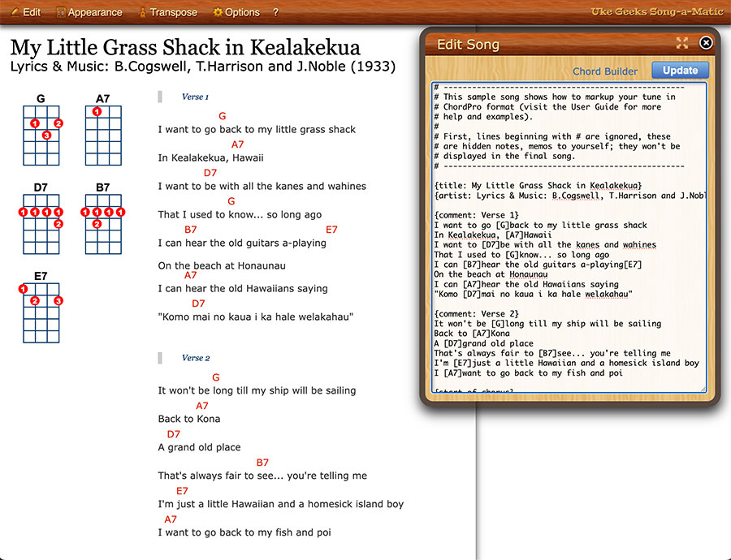

# UkeGeeks Song Editor

**[Try the demo](https://buzcarter.github.io/song-editor/)**

The **Song-a-Matic** editor from the [UkeGeeks Songbook](https://github.com/buzcarter/UkeGeeks): a browser editor for ChordPro songs with ukulele chord diagrams. It has a toolbar with an Edit Song box, Appearance (font and diagram sizes, layout, color themes), Transpose and tunings (GCEA, DGBE, ADF#B), print-ready paper sizes, a Chord Builder for custom chord diagrams, and a fullscreen editor with ChordPro highlighting.



```
npm install @ukegeeks/song-editor @ukegeeks/song-formatter
npm install @ukegeeks/ace-chordpro-extension   # optional: the Fullscreen editor
```

## What's in the package

| File | What it is |
|---|---|
| `dist/js/ugsEditorPlus.min.js` | The editor, as a browser script. Defines `window.ugsEditorPlus` and `window.ugsChordBuilder`. Also `ugsEditorPlus.merged.js`, unminified. |
| `dist/css/ugsEditorPlus.min.css` | The editor's styles (also `.merged.css`). |
| `dist/css/ugsEditorPlus.print.css` | Print styles. |
| `dist/img/editor/` | Images the CSS uses. `dist/` is laid out like a web page's `js/`, `css/` and `img/` folders: copy them side by side, since the CSS and `mount()` look for images at `../img/editor/`. |
| `dist/markup.js` | The editor's HTML, for server-rendered pages (Node: `require('@ukegeeks/song-editor')`). |
| `dist/ugsEditorPlus.d.ts`, `dist/markup.d.ts` | TypeScript declarations. `editorHtml()`'s come with `require` or `import`; for the browser globals, add `/// <reference types="@ukegeeks/song-editor/browser" />`. |

The editor doesn't bundle its two dependencies, so a page never gets a second copy:

- **Song Formatter** (`@ukegeeks/song-formatter`) reads ChordPro and draws the song and its SVG chord diagrams. Load its `dist/song-formatter.bundle.js` and `dist/css/ukeGeeks.music.css` first.
- **ACE ChordPro Extension** (`@ukegeeks/ace-chordpro-extension`) is the Fullscreen editor. It loads only when someone clicks Fullscreen, from the `aceUrl` folder (see below).

## Use it on a page

```html
<link rel="stylesheet" href="css/ukeGeeks.music.css" />
<link rel="stylesheet" href="css/ugsEditorPlus.min.css" title="ugsEditorCss" />
<link rel="stylesheet" href="css/ugsEditorPlus.print.css" media="print" />

<div id="songEditor"></div>

<script src="js/song-formatter.bundle.js"></script>
<script src="js/ugsEditorPlus.min.js"></script>
<script>
  const editor = ugsEditorPlus.songAmatic.mount(document.getElementById('songEditor'), {
    song: '{title: Hello}\n[C]Hello [G7]world',
    save: async (text) => {
      // write the song wherever your app keeps it
      return 'Saved.';
    },
  });
</script>
```

The editor stylesheet **must** have `title="ugsEditorCss"`: the editor changes font and diagram sizes by editing rules in it.

The editor finds its parts by `id`, so a page holds one editor.

### `ugsEditorPlus.songAmatic.mount(container, options)`

Writes the editor into `container` (an empty element), renders the song and returns `{ getSong() }`.

| Option | Default | |
|---|---|---|
| `song` | `''` | The ChordPro text to open. |
| `save` | none | `(text) => message`, or a promise of one. Called by the Save button; the message shows next to it. A rejection shows a "problem saving" alert. **Without `save` there's no Save button**, for read-only pages. |
| `aceUrl` | `ace/` in the folder `ugsEditorPlus.min.js` was loaded from | Folder (with trailing slash) holding `ace-chordpro.min.js`. |
| `imgUrl` | `../img/editor/` from the folder `ugsEditorPlus.min.js` was loaded from | Folder holding `busy.gif`. |
| any of `ugsEditorPlus.options` | | `showEditOnLoad`, `fontSize`, `diagramSize`, `diagramPosition`, `lyricStyle`, `paper`, `theme`, `tuning`, `hideChordEnclosures`, `sortAlphabetical`, `ignoreCommonChords`, `commonChords`. See `src/js/editor/ugsEditorPlus.options.ts`. |

`editor.getSong()` returns the text in the Edit Song box.

### Server-rendered pages

To render the editor's HTML on the server (no flash of an empty page), use `editorHtml()`, then call `init()` instead of `mount()`:

```js
const { editorHtml } = require('@ukegeeks/song-editor');

const html = editorHtml({
  canSave: true,          // show the Save button
  imgUrl: '/img/editor/',
  title, subtitle, artist, album, // pre-rendered into the songsheet
  body: chordProText,
});
```

```html
<script>
  ugsEditorPlus.songAmatic.init(options);
  ugsEditorPlus.updateSong.setSaveHandler(async (text) => 'Saved.');
</script>
```

Every value is HTML-escaped. The songsheet keeps existing entities such as `&amp;` (so `&copy;` shows ©); the Edit Song box gets the song's exact text, entities and all.

### Older pages

Pages built for the UkeGeeks Songbook 1.5 keep working: the markup copied into the page, then `ugsEditorPlus.songAmatic.init(options)` and `ugsEditorPlus.updateSong.init(ajaxUri, filename)`, which posts the song to the Songbook server.

## Develop

```
npm install
npm run lint        # eslint
npm run typecheck   # tsc
npm run build       # dist/
npm test            # needs a build first
```

The sources are TypeScript (`src/`), written as plain scripts rather than modules: no `import`/`export`, one shared global scope, joined into one bundle in the order `scripts/build.js` lists them. The build only strips the types from each file (`npm run typecheck` checks them), so the bundle is the same JavaScript as before the move to TypeScript. Each part of the editor declares its interface at the top of its file; the shipped declarations are hand-written in `src/types/` and the sources are checked against them.

### Demo

Live: **https://buzcarter.github.io/song-editor/**

```
npm run demo    # builds, then serves http://localhost:8098/
```

`demo/index.html` is a plain host page that calls `mount()` with one of the 16 sample songs from the Songbook (`demo/songs/`). The controls at the bottom right pick the song and turn the Save button on or off (`?song=…&save=0`). The demo's `save()` writes nothing: it logs the song to the console and returns a message. In the console, `demoEditor.getSong()` returns the current text.

`scripts/site.js` lays the site out: the page at the root, this package's build in `dist/`, and the two peer packages in `vendor/`. The local server (`scripts/demo.js`, no dependencies, 127.0.0.1 only) serves that layout straight from `demo/`, `dist/` and `node_modules/`; set `PORT` to use another port. `npm run build:site` writes the same layout to `.site/` as static files.

GitHub Actions (`.github/workflows/deploy-demo.yml`) builds and tests every pull request, and on a push to `main` publishes `.site/` to GitHub Pages. One-time setting: **Settings → Pages → Source: GitHub Actions**.

## Part of the UkeGeeks family


- **[ukegeeks.org](https://ukegeeks.org)**: edit a song online, the User's Guide, and the blog.
- **[UkeGeeks Songbook](https://github.com/buzcarter/UkeGeeks)**: your own songbook app, run with Node.js or PHP.
- **[Song Editor](https://github.com/buzcarter/song-editor)** (this repo): full-featured editor supporting transposing, choosing amoung styles, chord diagram sizes, and more.
- **[Song Formatter](https://github.com/buzcarter/song-formatter)** chord diagrams and songsheets on your own website.
- **[ACE ChordPro Extension](https://github.com/buzcarter/ace-chordpro-extension)**: ChordPro editing for the Ace code editor.

Not sure which one you need? See [which UkeGeeks tool is right for you](https://ukegeeks.org/projects/).

## License

GPL-3.0-or-later. Copyright 2010–2026 Buz Carter.
