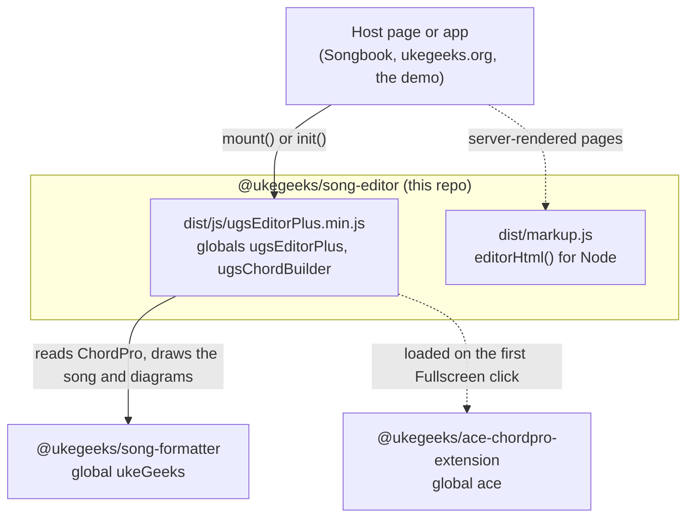
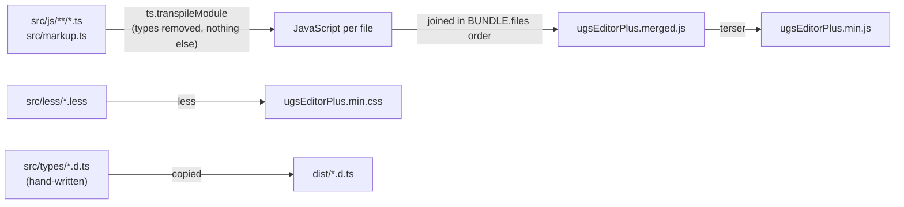
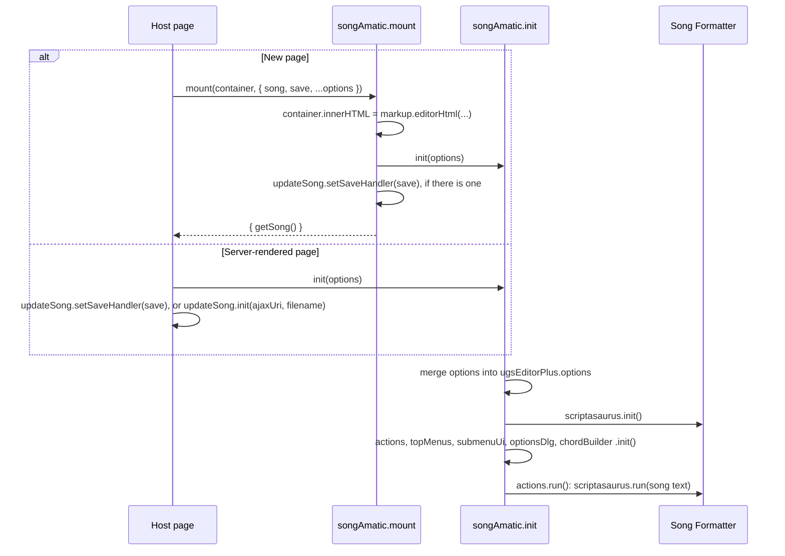
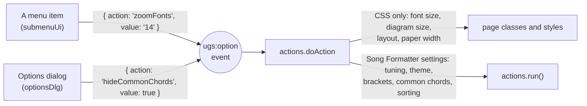
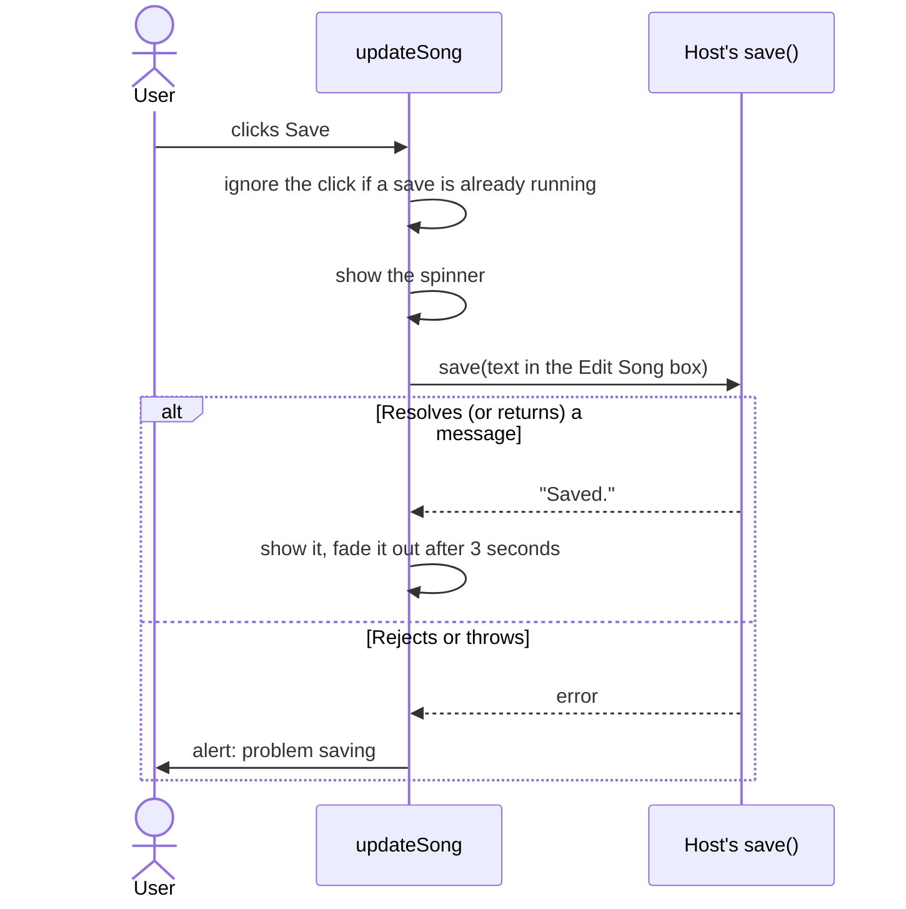
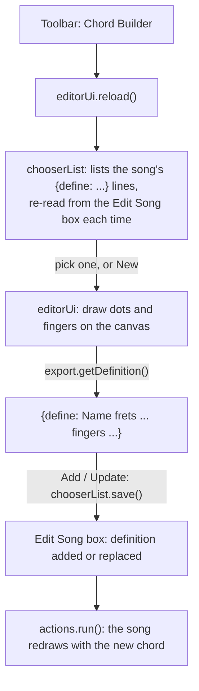

# How the editor works

A map of the source for someone about to change it. For using the editor on a page, see the [README](../README.md); for where it's going, the [ROADMAP](../ROADMAP.md).

## The pieces

The host page loads Song Formatter, then the editor bundle. The editor never bundles either dependency. It calls Song Formatter through the `ukeGeeks` global, and loads Ace with LazyLoad only when someone clicks Fullscreen.

The host decides where songs live: it hands the editor the song text and a `save` callback.

## How the source becomes the bundle

The sources are TypeScript, but written as **plain scripts**: no `import` or `export`. Every file adds its part to a shared global (`ugsEditorPlus.actions = (function() { ... }())`), and the build joins them into one file.

**The order in `scripts/build.js` matters.** A file can use, at load time, only what the files before it defined. `namespace` comes first because it creates `ugsEditorPlus`, and `dom` comes next because almost everything uses it. Inside functions that run later, any part can call any other, since by then the whole bundle has loaded.

The build doesn't check types; `npm run typecheck` does. Since the build only strips types, the bundle is the same JavaScript you'd get by deleting the type annotations by hand.

### Where the types live

| File | What it declares | Shipped? |
|---|---|---|
| `src/types/ugsEditorPlus.d.ts` | What host pages use: `Options`, `mount()`, `init()`, the Save handler, `dom` | Yes, as `dist/ugsEditorPlus.d.ts` |
| `src/types/markup.d.ts` | `editorHtml()` and `escapeHtml()` | Yes, as `dist/markup.d.ts` |
| `src/types/internal.d.ts` | Corrections to Song Formatter's types, and Ace, LazyLoad | No |
| The top of each source file | That part's interface, in `declare namespace UgsEditorPlus { ... }` | No |

Each source file starts with its own interface, then `interface UgsEditorPlus { actions: UgsEditorPlus.Actions; }` adds it to the global. TypeScript merges these declarations, so the global's type is complete without any file importing another.

## The parts

`ugsEditorPlus`, in load order:

| Part | Job |
|---|---|
| `namespace` | Creates the `ugsEditorPlus` global. |
| `dom` | Small DOM helpers that replaced jQuery: find, show and hide, fades, `draggable`, `postJson`, `trigger`. Also the editor's checked lookups (`byId`, `find`, `closest`), which throw a clear error when the page is missing an element. |
| `options` | The settings and their defaults. `init()` merges the page's options into it. |
| `actions` | The center: listens for `ugs:option` events and applies each setting, and `run()` redraws the song. Also transpose. |
| `songUi` | Puts the title, artist, album and meta lines on the page. |
| `styles` | Finds rules in the stylesheet titled `ugsEditorCss`, so `actions` can resize the diagrams by editing them. |
| `themes` | The color themes: the body class plus the colors Song Formatter draws with. |
| `optionsDlg` | The Other Options dialog's checkboxes and the Update button. Makes the dialogs draggable. |
| `reformat` | Converts "chord line above lyric line" text to ChordPro. |
| `autoReformat` | Offers `reformat` when a song has no chords. |
| `topMenus` | The toolbar: opens and closes menus and dialogs, and the Fullscreen button. |
| `submenuUi` | The menus' lists (font size, layout, tuning...). A click sends an `ugs:option` event. |
| `updateSong` | The Save button. |
| `aceHelp` | The help panel shown beside the Fullscreen editor. |
| `resize` | Fullscreen: loads Ace, moves the song into it and back. |
| `chordBuilder` | Connects the Chord Builder to the toolbar. |
| `markup` (`src/markup.ts`) | The editor's HTML. The same file is `dist/markup.js` for Node. |
| `songAmatic` | `init()`: starts every part in order. |
| `mount` (`src/js/mount.ts`) | `songAmatic.mount()`: writes the HTML, then calls `init()`. |

`ugsChordBuilder` is the Chord Builder: `ugsChordBuilder.ts` (settings, the fretboard and cursor canvases, the dots, `export`), `chooserList` (the list of the song's chords) and `editorUi` (the builder panel). `libs/lazyload.js` loads Ace.

## Starting up

There are two ways in. New pages call `mount()`. Pages whose server already wrote the editor's HTML (the Songbook, or anything using `editorHtml()`) call `init()` themselves.

The editor finds its elements by `id`, so a page holds one editor.

## Redrawing the song

The Edit Song box (`#chordProSource`) holds the song. Everything that changes the song changes that box's text, then calls `actions.run()`:

1. Song Formatter's `scriptasaurus.run(text)` reads the ChordPro and draws the songsheet and its chord diagrams.
2. If the song has no chords, `autoReformat` may offer to convert it.
3. `songUi.update()` fills in the title, artist and so on.
4. The first time, or when `run(true)` asks, the text is saved as the "original" for transposing.

Each Transpose choice counts from that original, not from the current text: picking "up 2" and then "up 3" ends 3 steps up, and "Original key" gives back exactly the song you started with. The Update button calls `run(true)`, so your edits become the new original.

## Changing a setting

Menus and the Options dialog don't call `actions` directly. They send an `ugs:option` event on `document`, and `actions` handles every one:

The possible actions and their values are in `OptionValues` at the top of `ugsEditorPlus.actions.ts`. To add a setting, add it there, send it from the menu or dialog, and handle it in `doAction`'s `switch`.

## Saving

Save sends the Edit Song box's text; Fullscreen copies its text back into that box when it closes. (`mount()`'s `getSong()` reads Ace while Fullscreen is open.) Without a `save` callback there's no Save button.

Songbook 1.5 pages call `updateSong.init(ajaxUri, filename)` instead, which makes a `save` that posts to the Songbook server.

## Fullscreen

The Fullscreen button (in the Edit Song dialog) calls `resize.toggle()`. The first time, it loads `ace-chordpro.min.js` from `options.aceUrl` (by default `ace/` next to the bundle). Opening copies the Edit Song box into Ace; closing copies it back.

## The Chord Builder

The builder has its own global, `ugsChordBuilder`, from when it was a separate library. It uses the editor's `dom` helpers and calls `actions.run()`, so it loads after the editor's parts.

## Song text is untrusted

A song can come from anywhere: pasted from a website, or from a shared songbook. Treat its text like user input:

- To show song text on the page, set `textContent`, or escape it before using `innerHTML` (`ukeGeeks.toolsLite.escapeHtml`, or `markup.escapeHtml`).
- `scriptasaurus.run()` escapes the whole song before reading it, so the song's title, artist and lyrics come back escaped. Text read straight from the Edit Song box doesn't.
- `editorHtml()` escapes every value it's given.

The tests in `test/mount.test.js` include song text that tries to become markup.

## Rough edges

These are known and kept on purpose for now; see [CHANGELOG](../CHANGELOG.md) and the ROADMAP for the plan.

- **Globals and load order** instead of modules. Moving to ES modules would remove the `var _public = {} as X` lines and the build's file list, but every host page, and the Songbook, loads the bundle as a script.
- **One editor per page**, because every part finds its elements by `id`.
- **Constructor functions** (`ugsChordBuilder.editorUi`, the `entities`) are typed with casts until they become classes.
- **The Chord Builder's canvas modules** keep their drawing context in a variable that `init()` sets.
- The public `dom.on()` handler and `dom.postJson()` result are typed `any`, because the Songbook calls them.
